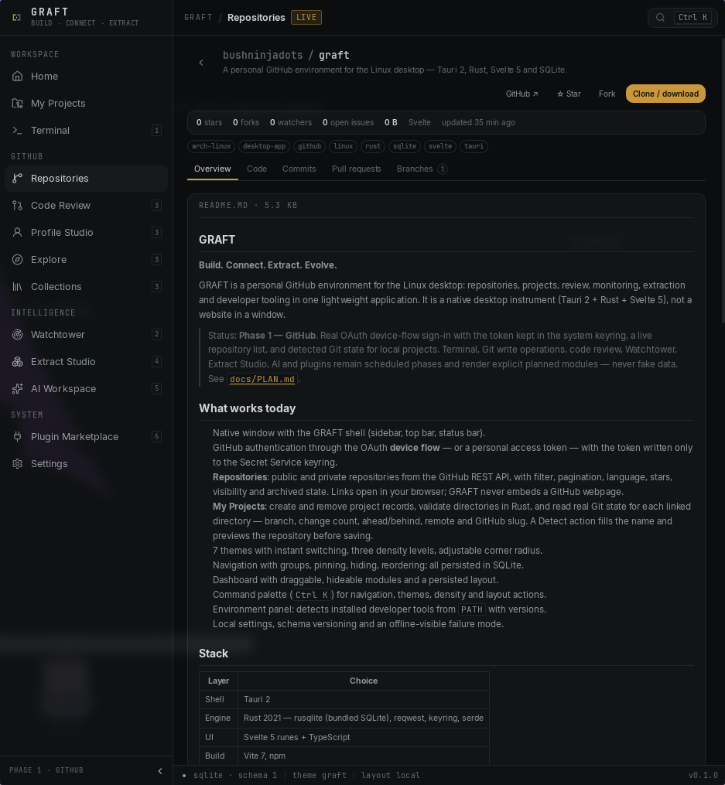

# GRAFT

**Build. Connect. Extract. Evolve.**

GRAFT is a personal GitHub environment for the Linux desktop: repositories, projects,
review, monitoring, extraction and developer tooling in one lightweight application.
It is a native desktop instrument (Tauri 2 + Rust + Svelte 5), not a website in a
window.

> Status: **Phase 1–3**. Real OAuth device-flow sign-in with the token kept in the
> system keyring, a live repository list, an in-app repository workspace (README, code,
> commits with diffs, pull requests, issues, branches), star/fork/clone, editing text
> files in repositories where you have push access, and Git actions for local
> projects — fetch, pull, push, commit and branch create/switch. Profile Studio is a
> visual profile builder: presets and layouts, profile picture, pinned repositories,
> stats, contribution activity map, achievements, organisations and live README
> preview, stored as a local draft with explicit publish, plus a live GitHub status
> editor. Repository discovery searches public GitHub by keyword, language, topic and
> author. A notification centre keeps local pushes, pulls, checkouts, edits, forks and
> issues, and imports unread GitHub activity; sync refreshes active data on focus and
> on a timer. Terminal, review actions, Watchtower, standalone Collections, Extract
> Studio, AI and plugins remain scheduled phases and render explicit planned modules —
> never fake data. See [`docs/PLAN.md`](docs/PLAN.md).



## What works today

- Native window with the GRAFT shell (sidebar, top bar, status bar).
- GitHub authentication through the OAuth **device flow** — or a personal access
  token — with the token written only to the Secret Service keyring.
- **Repositories**: public and private repositories from the GitHub REST API, with
  filter, pagination, language, stars, visibility and archived state. Links open in
  your browser; GRAFT never embeds a GitHub webpage.
- **Explore**: search public GitHub repositories from the Repositories view by
  keyword, language, topic and author. Quick topics include Hyprland, ricing, Linux,
  Arch, dotfiles, Wayland, NixOS and Rust; results show topics, language and stars and
  open straight into the repository workspace.
- **Repository workspace**: README, directory tree, file text, branches, commit
  history with diffs, pull requests with descriptions and file diffs, and issues
  with descriptions and labels — read inside GRAFT instead of a browser tab.
- **Editing**: text files can be edited and committed from the Code tab when the
  GitHub API reports push access. The commit is a two-step confirmation with the
  branch, path and message visible before anything is written.
- **Actions**: star/unstar, fork, create issues, and clone/download through the Git
  CLI, with an add-to-projects step after cloning. Linked projects can fetch, pull
  and push, and stage-all, commit and create or switch branches with a confirmation
  step.
- **Notifications**: a persistent bell keeps pushes, pulls, checkouts, commits, file
  edits, forks and issues, and imports unread GitHub notifications from the website
  (mentions, reviews, issues, pull requests, workflow activity). Each item stays until
  opened, then routes to the affected repository tab; the brief toast is also
  clickable. Opening a notification locally never marks it read on GitHub.
- **Sync**: active GitHub data refreshes when the window gains focus, every 90 seconds
  while signed in, and from the TopBar sync button; repository and profile views have
  their own Refresh action. Sync is read-only — local Git work is only sent online by
  your explicit push.
- **Repository layouts**: list, card and compact views, remembered locally.
- **Profile Studio**: a visual builder for the GitHub profile README — layouts
  (banner, split, compact, terminal), five presets, profile picture, pins, stats,
  contribution activity map, achievements, organisations, custom Markdown, accent
  and badge styling, plus a live status editor for your GitHub emoji and message.
  The generated README is stored as a local SQLite draft, diffed against the live
  README and only uploaded after an explicit confirmation. GRAFT can also create the
  `<login>/<login>` profile repository behind its own confirm. Status writes need the
  `user` scope; the studio can start the device-flow reauthorisation without leaving
  the page.
- Markdown is rendered and sanitized locally (marked + DOMPurify); README links
  still open in your browser.
- **My Projects**: create and remove project records, validate directories in Rust,
  and read real Git state for each linked directory — branch, change count,
  ahead/behind, remote and GitHub slug. A Detect action fills the name and previews
  the repository before saving.
- 7 themes with instant switching, three density levels, adjustable corner radius.
- Navigation with groups, pinning, hiding, reordering; all persisted in SQLite.
- Dashboard with draggable, hideable modules and a persisted layout.
- Command palette (`Ctrl K`) for navigation, themes, density and layout actions.
- Environment panel: detects installed developer tools from `PATH` with versions.
- Local settings, schema versioning and an offline-visible failure mode.

## Stack

| Layer | Choice |
| ----- | ------ |
| Shell | Tauri 2 |
| Engine | Rust 2021 — rusqlite (bundled SQLite), reqwest, keyring, serde |
| UI | Svelte 5 runes + TypeScript (marked + DOMPurify for Markdown) |
| Build | Vite 7, npm |
| Design | CSS token system driven by the theme engine |

## Requirements (Arch / EndeavourOS)

```bash
sudo pacman -S --needed base-devel rust nodejs npm \
  webkit2gtk-4.1 gtk3 libsoup3 librsvg imagemagick
```

For GitHub sign-in, a Secret Service provider must be running — `gnome-keyring` or
KWallet. Without one GRAFT reports that the keyring is unavailable instead of
falling back to a plaintext token.

Optional tooling GRAFT reports on if present: `git`, `github-cli`, `python`, `go`,
`docker`, `podman`, `openssh`, `gnupg`, `fish`, `zsh`, Hyprland (`hyprctl`).

## Run

```bash
npm install
npm run app:dev        # desktop window (Vite dev server on :1420)
```

Production build:

```bash
npm run app:build      # release binary + deb/appimage bundles in src-tauri/target/release/bundle
```

Verification:

```bash
npm run check          # svelte-check: TypeScript + template diagnostics
npm run build          # production frontend bundle
npm run check:rust     # cargo check
npm run verify         # all three
cargo test --manifest-path src-tauri/Cargo.toml   # unit tests
```

`npm run dev` alone serves the UI in a browser. The Rust backend is absent there by
design; the interface shows a clear offline state instead of pretending to work.

## Connecting GitHub

1. Create a GitHub OAuth app under **Settings → Developer settings → OAuth Apps** and
   enable **Device Flow**. No client secret is used or stored.
2. In **Repositories**, paste the app's client ID and press **Save**.
3. Press **Connect GitHub**, then enter the displayed code at
   `github.com/login/device`.

The device flow requests `repo`, `read:user` and `user` (status writes). A personal
access token with the same scopes is accepted as an alternative and verified against
`api.github.com` before it is stored. Existing tokens issued before the `user` scope
was added can be reauthorised from Profile Studio when setting a status.

## Layout

```
src/                  Svelte 5 interface
  views/              Home, Projects, Repositories, Repository, ProfileStudio, Settings, ModuleView
  lib/components/     shell, palette and dashboard panels
  lib/state/          reactive state (appearance, nav, dashboard, github, notifications, sync, session, ui)
  lib/api.ts          the only IPC surface
src-tauri/src/        Rust engine (commands, db, schema, github, git, secrets, tools)
  src-tauri/src/schema/  versioned SQL migrations
docs/                 plan, architecture, design, product brief
scripts/              icon rendering
```

## Storage and security

- Database: `~/.local/share/dev.graft.desktop/graft.db` (SQLite, WAL).
- Secrets: GitHub tokens live in the system keyring (`dev.graft.desktop` service).
  They are never written to SQLite, logs, localStorage or the webview.
- Network: all GitHub requests are made by Rust. The webview CSP allows no external
  connections and images only from GitHub's avatar, raw, camo and shields.io badge hosts.
- Repository file writes are available only when the GitHub API reports push access,
  and require a second confirmation naming the branch, path and commit message.
  Profile repository creation and status changes are separate confirmed writes.
  Background sync and notification import are read-only.
- External links: `open_external` accepts `http(s)` only.
- Local Git access is inspection of directories you explicitly link, plus the
  fetch/pull/push actions you trigger. Cloning only writes to the destination you
  confirm, and refuses to overwrite an existing folder.
- Markdown from GitHub is sanitized with DOMPurify before it reaches the DOM.

## Documentation

- [`docs/PLAN.md`](docs/PLAN.md) — phases, decisions, open questions.
- [`docs/ARCHITECTURE.md`](docs/ARCHITECTURE.md) — boundaries, IPC, schema, security.
- [`docs/DESIGN.md`](docs/DESIGN.md) — visual identity and token contract.
- [`docs/SPEC.md`](docs/SPEC.md) — binding product requirements.
- [`AGENTS.md`](AGENTS.md) — working rules for contributors and coding agents.
